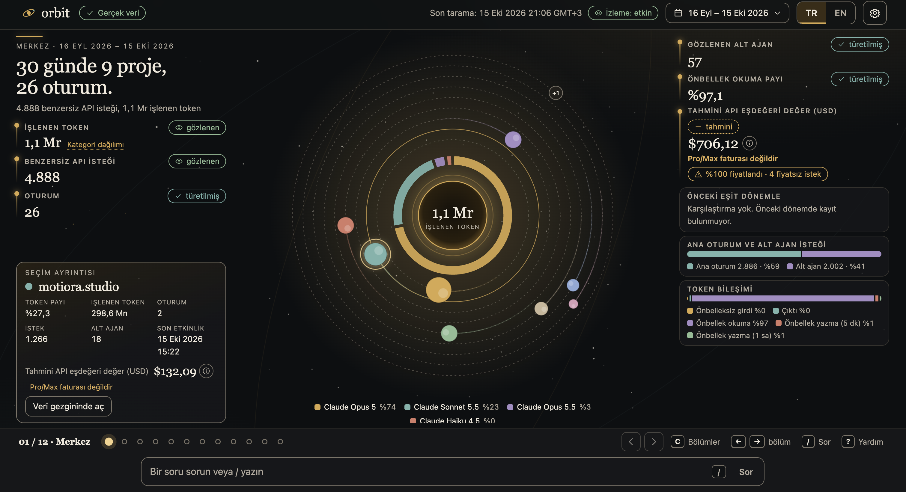

# Orbit

Open-source, local-first observability for [Claude Code](https://docs.anthropic.com/en/docs/claude-code). Orbit reads the session history already on your computer and tells that story as one interactive scene: projects, sessions, models, tokens, subagents, and an estimated API-equivalent value.

Everything runs on `127.0.0.1`. There is no account, API key, or telemetry.



*Center chapter (01/12). The interface defaults to Turkish; English is one click away.*

## Install

Node.js **22.13 or newer** (24 recommended) and npm.

```bash
git clone https://github.com/ismailcankaratas/orbit.git
cd orbit
npm install
npm run dev
```

Open [http://127.0.0.1:5173](http://127.0.0.1:5173).

The first screen offers two paths:

- **Explore the synthetic demo** — made-up sessions, so you can look around before pointing Orbit at anything personal.
- **Scan my local history** — read-only scan of `~/.claude/projects`, or a folder you choose. Orbit does not modify Claude settings, transcripts, credentials, or your code.

To run the built app on a single port:

```bash
npm start
```

Then open [http://127.0.0.1:4317](http://127.0.0.1:4317).

| Variable | Default | Purpose |
| --- | --- | --- |
| `ORBIT_PORT` | `4317` | API port. In dev, the page is on port `5173` and proxies to this port. |
| `ORBIT_DATA_DIR` | see below | Where Orbit keeps its own database and settings. |

Orbit's data directory (separate from Claude's files):

- macOS: `~/Library/Application Support/Orbit`
- Linux: `$XDG_DATA_HOME/orbit` or `~/.local/share/orbit`
- Windows: `%APPDATA%\Orbit`

## What you can do

**0.1 alpha** ships the shell and the Center chapter. Chapters 02–12 appear in the catalog as planned.

| Chapter | Status |
| --- | --- |
| 01 Center — period headline, orbital project map, model mix, token and value readouts | Available |
| 02–12 Orbits, Sessions, Orchestration, Time, Models, Cache, Value, Rhythm, Findings, Scope, Export | Planned |

Also in this release:

- **Orbit Ask** answers a fixed set of questions from local data (tokens, sessions, top project, estimated value, and similar). `/` opens the chapter list. No model call and no network.
- **Turkish and English.** Turkish is the default.
- **Date range** in the top bar (7 / 30 / 90 days or a custom range).
- **Demo and real data stay in separate databases**, with a visible badge for whichever is active.
- **Local CSV and JSON export**, settings, and a delete action that removes Orbit's archive only.
- **Keyboard:** `←` `→` move between ready chapters, `C` opens the catalog, `?` shows shortcuts, `Esc` closes overlays.

Projects, sessions, agents, timeline, costs, and reports remain available as secondary views from a selection or from Orbit Ask (`/gezgin projeler`, and the same pattern for the other views).

## Privacy

- The server binds to `127.0.0.1` only.
- Scanning starts after you consent. The default folder is `~/.claude/projects`.
- Orbit stores normalized metadata: timestamps, opaque ids, token counts, model ids, and link confidence. Prompt text, tool output, and credentials are not archived.
- Switching the archive off drops rows whose source file disappears. Switching it on keeps the numeric summary after the source file is gone.
- Dependencies are fetched when you install. The running app does not send usage anywhere.

Details: [`docs/SECURITY_PRIVACY.md`](docs/SECURITY_PRIVACY.md).

## Estimated value

Amounts are **Estimated API-equivalent value (USD)** from a versioned rate schedule bundled with the app (`anthropic-2026-10-15`). They describe what the same token counts would cost on Anthropic's public API prices.

They are separate from a Claude Pro or Max invoice, subscription spend, and remaining quota. Unknown models stay unpriced and are counted in the coverage chip. The schedule is overridable locally and is never downloaded at runtime.

## Development

```bash
npm run typecheck
npm run lint
npm run test
npm run test:e2e
npm run verify    # typecheck, lint, unit tests, build, Playwright
```

Workspaces: `packages/core` (parser, attribution, pricing), `packages/test-fixtures`, `apps/server` (Fastify, `node:sqlite`), `apps/web` (React, Vite). Product and architecture notes live in [`docs/`](docs/).

## License

[MIT](LICENSE). Orbit is an independent project and is not affiliated with Anthropic.

## Türkçe

Orbit, bilgisayarınızdaki Claude Code oturum geçmişini okuyan, açık kaynak ve tamamen yerel bir gözlem uygulamasıdır. Hesap, API anahtarı ve telemetri yoktur. Arayüz varsayılan olarak Türkçedir.

```bash
git clone https://github.com/ismailcankaratas/orbit.git
cd orbit
npm install
npm run dev
```

[http://127.0.0.1:5173](http://127.0.0.1:5173) adresini açın. İlk ekranda sentetik demoyu gezebilir veya `~/.claude/projects` klasörünü salt okunur taratabilirsiniz. Üretim derlemesi için `npm start`, ardından [http://127.0.0.1:4317](http://127.0.0.1:4317).

Ekrandaki tutarlar **tahmini API eşdeğeri değerdir (USD)**. Claude Pro/Max faturası, abonelik harcaması veya kalan kota değildir. Sunucu yalnızca `127.0.0.1` üzerinde dinler. Ayrıntılı gizlilik modeli: [`docs/SECURITY_PRIVACY.md`](docs/SECURITY_PRIVACY.md). Lisans: [MIT](LICENSE).
